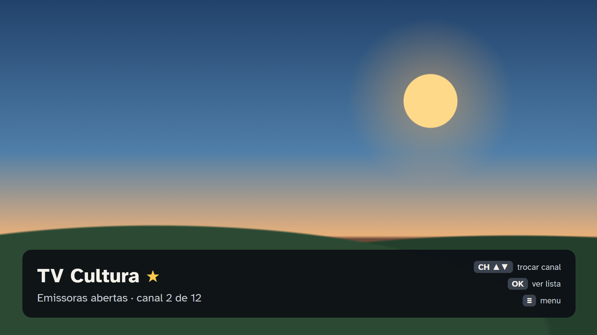
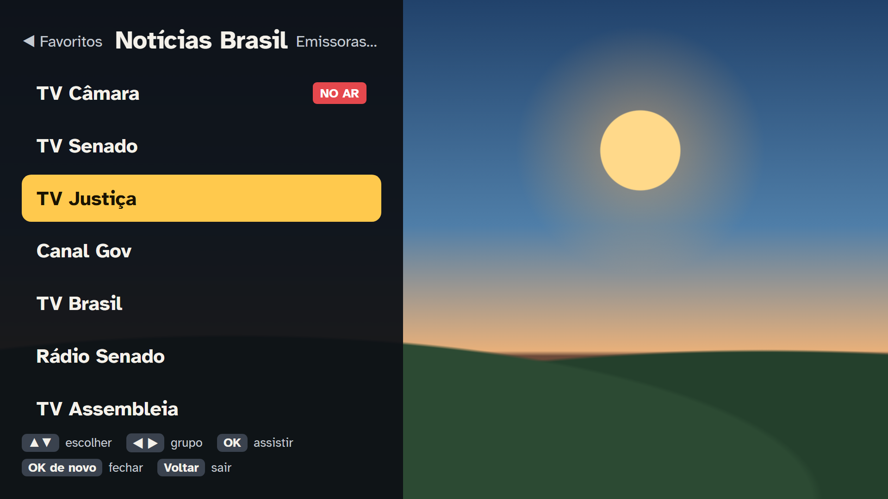
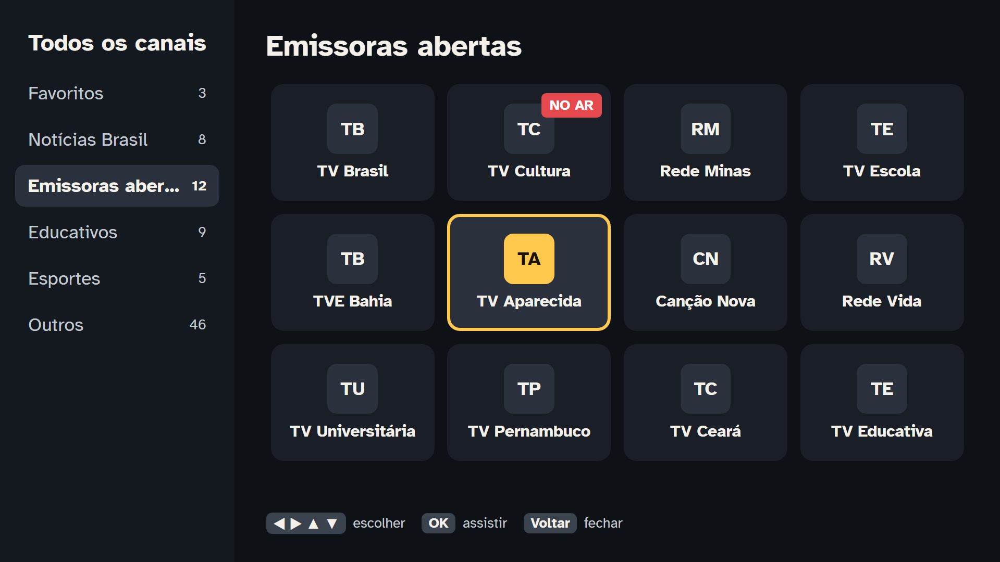
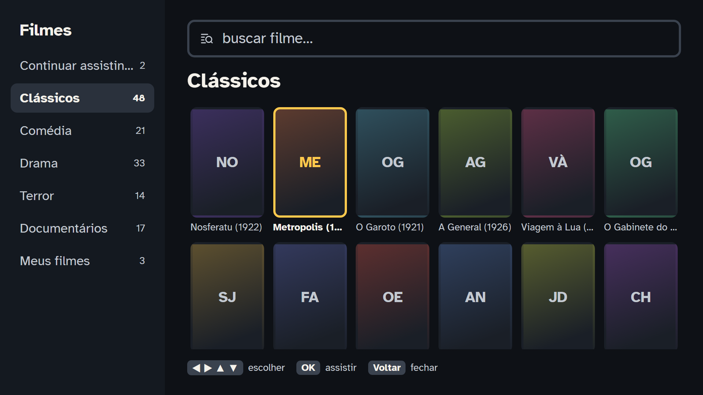
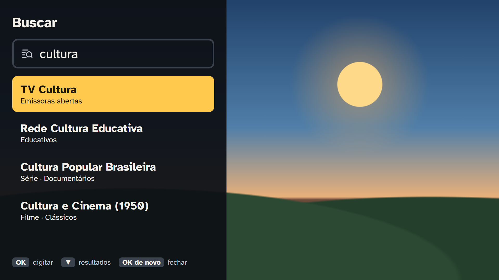
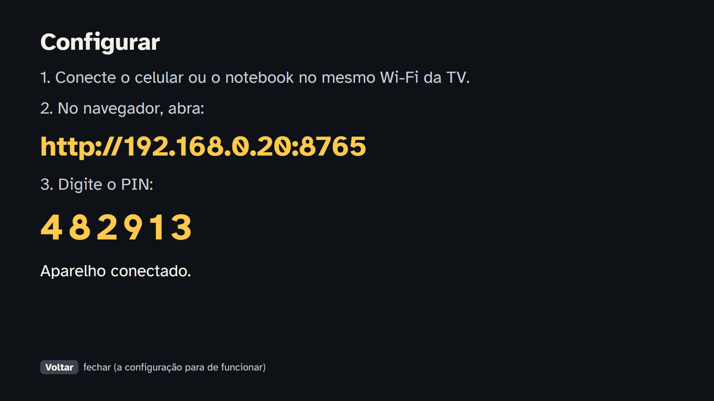
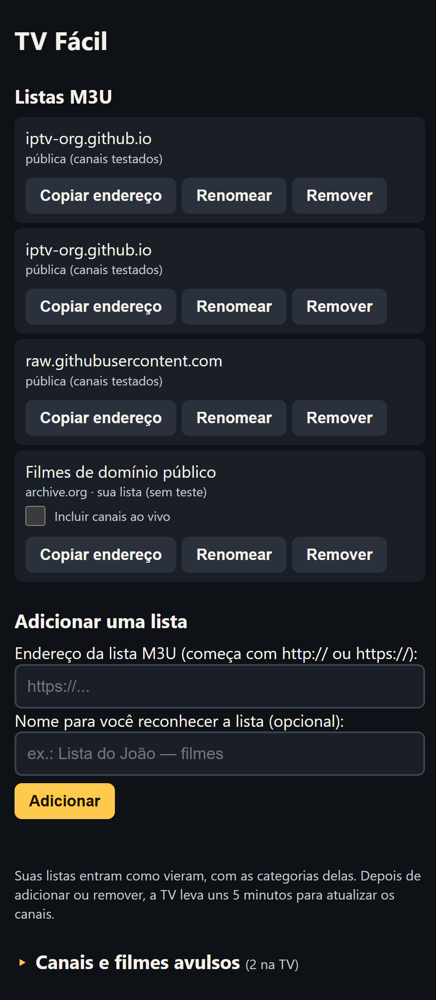
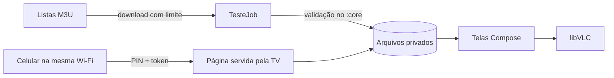

# TV Fácil

[](https://github.com/pedroeq-hash/tv-facil/actions/workflows/testes.yml)
[](https://github.com/pedroeq-hash/tv-facil/releases)
[](LICENSE)

Player IPTV simples para Android TV, feito para quem só quer ligar a TV e assistir.

O TV Fácil lê listas M3U e mostra os canais em grupos, com letras grandes, poucos botões e tudo pelo controle remoto. Ele abre direto no último canal visto. Também mostra filmes e séries de listas M3U, com capas e "Continuar assistindo". Foi pensado para quem tem pouca familiaridade com tecnologia e para rodar num stick Android TV barato (32 bits, 2 GB de RAM).



| Lista sobre o vídeo | Todos os canais |
|---|---|
|  |  |
| **Filmes** | **Busca única** |
|  |  |

<sub>Telas ilustrativas com dados de exemplo: canais públicos e filmes de domínio público. Elas reproduzem as cores, a fonte e as medidas do app.</sub>

## De onde veio

Um amigo comprou um stick Android TV barato para uma pessoa da família, que tem pouca familiaridade (e pouca paciência) com tecnologia. Ele queria canais abertos e alguns filmes gratuitos, sem complicação. O plano inicial era só um "detox" do aparelho:

1. **Revisão do aparelho** pelo ADB, atrás de qualquer app estranho. Apareceu um AnyDesk (acesso remoto) instalado sem o conhecimento do dono, que foi desativado. Tudo sem root: apps só desativados, com backup antes e cada mudança registrada com o comando para desfazer.
2. **Tela inicial mais limpa**, trocando o launcher padrão.
3. **Players prontos de IPTV**, testados e descartados: todos tinham configurações complexas demais para quem só quer ligar a TV e assistir.

Então veio o app próprio. Primeiro, um script em Bash no Termux testava os canais a cada 6 h (está em [`pipeline/`](pipeline/)); na versão 0.22 esse teste passou para dentro do app.

## Conteúdo

O TV Fácil é **só o player**: ele não traz nem vende conteúdo. As únicas listas que vêm configuradas são as públicas do [iptv-org](https://github.com/iptv-org/iptv) e do [Free-TV](https://github.com/Free-TV/IPTV), com canais abertos e gratuitos. Quem usa pode acrescentar outras listas M3U a que tenha direito de acesso. O uso deve respeitar os direitos e as licenças de cada conteúdo.

## Funções

- **Canais ao vivo testados a cada 6 h.** O app baixa as listas públicas, testa cada canal e mostra só os que respondem, organizados em grupos (Notícias, Emissoras abertas, Esportes…).
- **Feito para o controle remoto.** CH ▲▼ troca de canal, OK abre a lista sobre o vídeo, ≡ abre o menu e Voltar sempre volta um passo. Tem favoritos, canal anterior e uma grade com todos os canais.
- **Busca única.** Encontra canais, séries e filmes de uma vez, sem acento e sem maiúsculas ("camara" acha "TV Câmara").
- **Filmes e séries de listas M3U.** Capas, temporadas, retomada de onde parou, "Continuar assistindo" (some sozinho depois de 30 dias) e avanço rápido segurando ◀▶.
- **Configuração pelo celular.** A TV mostra um endereço e um PIN; no navegador do celular ou do notebook dá para:
  - adicionar e renomear listas;
  - cadastrar um canal ou filme avulso;
  - esconder categorias (controle dos pais);
  - ver o que a TV fez, em frases simples.
- **Atualização automática** pelo [Obtainium](https://github.com/ImranR98/Obtainium), lendo as [Releases](https://github.com/pedroeq-hash/tv-facil/releases) deste repositório.

| Configurar (na TV) | Página no celular |
|---|---|
|  |  |

## Arquitetura



- **`:core`**: Kotlin puro, sem Android. Toda a lógica fica aqui e foi escrita com TDD: leitura de M3U, teste de canais, biblioteca de filmes e séries, navegação pelo controle, busca, servidor da página. São **143 testes**, que rodam no PC sem TV.
- **`:app`**: camada fina com Jetpack Compose for TV e libVLC.

Mais detalhes em [docs/arquitetura.md](docs/arquitetura.md).

## Destaques técnicos

- **Listas enormes num aparelho fraco.** Uma lista de teste com 85 MB e ~316 mil itens é lida aos pedaços, direto do arquivo, sem nunca ficar inteira na memória. As capas são reduzidas e ficam em cache com limite.
- **Vídeo fluido.** Na 1ª versão, 99% dos quadros engasgavam. Isso foi resolvido com release otimizado (R8), vídeo direto do decodificador para a tela e perfis de compilação.
- **Segurança.** Todo dado que chega pela rede é tratado como não confiável:
  - só `http`/`https`, com tamanhos limitados e sem caracteres invisíveis;
  - credenciais das listas só no armazenamento privado, e o log grava só o domínio;
  - a página de configuração só existe com a tela aberta e exige PIN, token e conferência de `Host`/`Origin`.

  Análise completa em [docs/seguranca.md](docs/seguranca.md).

## Instalar

Baixe o APK da [última release](https://github.com/pedroeq-hash/tv-facil/releases/latest). Ele é só para `armeabi-v7a` (Android TV de 32 bits, Android 10 ou mais novo). Para receber as versões novas sozinho, adicione este repositório no Obtainium.

## Compilar

Requisitos: JDK 17 e Android SDK (platform 37).

```powershell
. .\ferramentas\env.ps1          # opcional: ativa JDK/SDK portáteis só nesta sessão do PowerShell
cd tvapp
.\gradlew.bat :core:test          # testes da lógica
.\gradlew.bat :app:assembleRelease
```

A chave de assinatura fica fora do repositório; sem ela, o release sai sem assinatura.

## Pastas

| Pasta | O que tem |
|---|---|
| `tvapp/core` | Lógica em Kotlin puro, com testes. |
| `tvapp/app` | App Android TV: telas, player, jobs e a página de configuração (`assets/config.html`). |
| `docs/` | Arquitetura, segurança e imagens. |
| `pipeline/` | 1ª versão do teste de canais, em Bash no Termux. Substituída pelo teste dentro do app na versão 0.22; fica como registro. |
| `ferramentas/` | `env.ps1`: JDK, Android SDK e Gradle portáteis (em `C:\dev\android-tools`), sem mexer no sistema. |

## Licenças

- Código deste repositório: [MIT](LICENSE).
- [libVLC](https://code.videolan.org/videolan/vlc-android) (reprodução de vídeo): LGPL-2.1 ou posterior.
- Fonte [Atkinson Hyperlegible](https://www.brailleinstitute.org/freefont/): SIL Open Font License 1.1 ([licença](tvapp/app/FONTE-LICENCA-OFL.txt)).

Desenvolvido com auxílio do [Claude Code](https://claude.com/claude-code).
