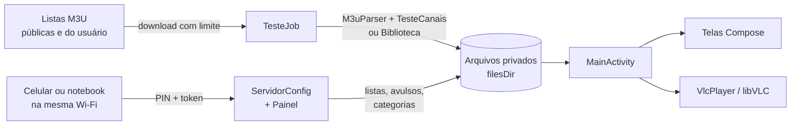

# Arquitetura

O TV Fácil é um player de listas M3U para Android TV. Foi pensado para um aparelho barato, um stick Android TV 10 de 32 bits com 2 GB de RAM, e para quem só usa o controle remoto.

## Módulos

```
tvapp/
  core/   Kotlin puro (JVM), sem Android. Toda a lógica, escrita com TDD.
  app/    Android TV: telas em Jetpack Compose for TV, vídeo com libVLC. Camada fina.
```

**`:core`**: cada arquivo é uma regra testável sem TV.

| Arquivo | O que faz |
|---|---|
| `M3uParser` | Lê `#EXTINF` e `#EXTVLCOPT` (user-agent, referrer). Aceita só `http`/`https`, corta tamanhos, tira caracteres invisíveis e limpa marcas de qualidade do nome. Lê em `Sequence`, para listas de qualquer tamanho. |
| `TesteCanais` | Junta as listas públicas, decide se a resposta de um canal é vídeo de verdade, classifica em grupos e monta a lista final. |
| `Biblioteca` | Separa canal ao vivo, filme e episódio; agrupa episódios em séries e temporadas; grava e lê o índice das séries. |
| `Navegacao` | Máquina de estados do controle remoto: tecla + tela atual → nova tela + efeito (trocar canal, pausar, pular…). |
| `Catalogo`, `Busca`, `Zapper` | Ordem dos grupos, siglas, busca sem acento e sem maiúsculas, próximo/anterior. |
| `Http`, `Painel` | Leitura de pedidos HTTP com limites e as rotas da página de configuração. |
| `Fontes`, `Escondidas`, `Capa`, `Resumo` | Listas configuradas, categorias escondidas, endereço seguro das capas e o registro em frases simples. |
| `Bloqueio`, `Retomar`, `Recentes`, `Posicao` | Canal que derrubou o player, ponto de retomada, "Continuar assistindo" com validade de 30 dias. |

**`:app`**:

| Arquivo | O que faz |
|---|---|
| `MainActivity` | Estado da tela, teclas do controle (via `Navegacao`), favoritos e posições em `SharedPreferences`. |
| `Telas` | As telas em Compose: assistindo, lista sobre o vídeo, grade, filmes e séries com pôster, busca e configurar. |
| `VlcPlayer` | libVLC com saída direta para a tela (`android_display`) e decodificador de hardware. |
| `TesteJob` | Jobs do Android: testa os canais a cada 6 h e monta a biblioteca de filmes e séries 1 vez por dia. |
| `ServidorConfig` | Servidor HTTP da página de configuração; só existe com a tela "Configurar" aberta. |
| `Capas`, `BibliotecaLida`, `Arquivos` | Carregador de capas, cache da biblioteca no processo e caminhos dos arquivos privados. |

## Fluxo dos dados



- **Canais ao vivo** (a cada 6 h): as listas públicas são baixadas e cada canal é testado (4 ao mesmo tempo, 10 s, só os primeiros 4 KB). O que responde vira `canais_ok.m3u`, organizado em grupos. Listas do usuário entram sem teste, com os grupos delas: quem dá acesso a elas costuma limitar as conexões simultâneas.
- **Filmes e séries** (1 vez por dia): a lista é baixada direto para um arquivo e lida aos pedaços. Os filmes vão para `filmes.m3u`, cada série para `series/<n>.m3u` e o índice para `series.tsv`. A biblioteca nova é montada numa pasta separada e trocada de uma vez no fim.
- **Telas**: leem só os filmes e o índice das séries. Os episódios são lidos do disco quando a série é aberta.

## Decisões e porquês

- **Lógica no `:core`, Android fino.** O comportamento do controle (que tecla faz o quê em cada tela) é uma função pura, `Navegacao.reagir`. Dá para testar tudo no PC, sem TV.
- **libVLC em vez de ExoPlayer.** Toca praticamente tudo que aparece em listas M3U. No diagnóstico, ~97% dos canais abriram. O ExoPlayer foi testado e ficou mais pesado no stick.
- **JobScheduler, sem dependência nova.** Os jobs são persistentes (voltam depois de religar) e exigem rede. Um job para canais e outro para a biblioteca, porque o Android corta cada job em ~10 min.
- **Página servida pela TV em vez de um app de celular.** Nada para instalar; qualquer navegador da casa configura. A segurança está em [seguranca.md](seguranca.md).
- **Atualização por GitHub Releases + Obtainium.** O APK é assinado com uma chave que nunca entra no repositório. Atualizar mantém favoritos e configurações.

## Desempenho num aparelho fraco

| Problema | Solução |
|---|---|
| Lista de 85 MB e ~316 mil itens; o app tem 256 MB de heap | Leitura em `Sequence` direto do arquivo; limites de 60 mil filmes, 20 mil séries e 5 mil episódios por série. A lista inteira nunca fica na memória. |
| Busca em 40 mil nomes a cada letra | Índice com os nomes já normalizados, montado uma vez em segundo plano. |
| 99% dos quadros com engasgo na 1ª versão | Release com R8, vídeo direto do decodificador para a tela (`android_display`), sem escala no foco, `compile -m speed-profile`. |
| Pôsteres de 106 KB cada | Tamanho `w185` (17 KB) quando a capa vem do TMDB, decodificada em ~200×300 `RGB_565`, LruCache de 24 MB, cache em disco de 50 MB e só 2 downloads por vez, para não disputar banda com o vídeo. |
| Reabrir o app relia 30 mil filmes (15–30 s) | Leitura guardada no processo (`BibliotecaLida`); se uma leitura falha, fica a anterior. |
| Segurar ◀▶ recarregava o vídeo a cada repetição | A barra mostra uma prévia com velocidade crescente (`Pulo.alvo`) e o vídeo pula uma vez só, ao soltar. |

## Pipeline da 1ª versão (`pipeline/`)

Antes do teste dentro do app, os canais eram testados por scripts Bash no Termux (`testa_canais.sh`, com `curl`). Na versão 0.22 o `TesteJob` passou a fazer o mesmo trabalho. A comparação no mesmo minuto deu 329 de 496 canais no app contra 328 no Termux. As regras do script viraram os testes do `TesteCanais`. Os scripts ficam no repositório como registro.
